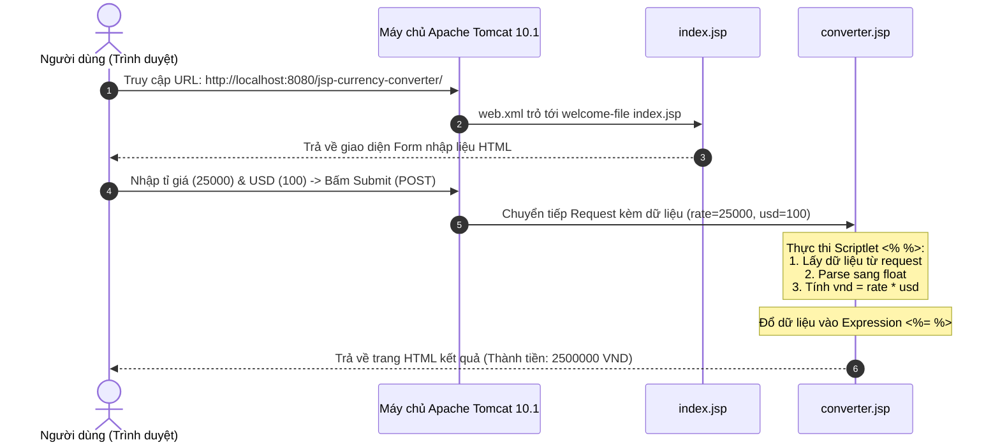

# TÀI LIỆU REVIEW CHI TIẾT DỰ ÁN: ỨNG DỤNG CHUYỂN ĐỔI TIỀN TỆ (JSP CURRENCY CONVERTER)

---

## 1. TỔNG QUAN DỰ ÁN

- **Tên dự án**: `jsp-currency-converter` (Ứng dụng Chuyển đổi Tiền tệ)
- **Mục tiêu học tập**:
  1. Hiểu cách tổ chức cấu trúc một dự án Maven Webapp tiêu chuẩn.
  2. Hiểu cơ chế hoạt động của JSP (JavaServer Pages) trong môi trường **Tomcat 10.1+** (sử dụng chuẩn **Jakarta EE 10** thay cho `javax.*` truyền thống).
  3. Nắm vững luồng truyền nhận dữ liệu HTTP Request/Response giữa các trang web.
  4. Sử dụng thành thạo hai thành phần cốt lõi của JSP cơ bản:
     - **JSP Scriptlet (`<% ... %>`)**: Chứa code logic Java thuần.
     - **JSP Expression (`<%= ... %>`)**: Hiển thị kết quả trực tiếp ra HTML.
- **Thư mục lưu trữ**: `D:\cac_modune_codegym\modune_3\2.bai_tap\10.JSP_va_JSTL\1.ung_dung_chuyen_doi_tien_te`

---

## 2. CẤU TRÚC THƯ MỤC TIÊU CHUẨN

```text
1.ung_dung_chuyen_doi_tien_te/
│
├── pom.xml                                   <-- Cấu hình toàn bộ dự án Maven, dependencies & plugins
├── README.md                                 <-- Hướng dẫn cài đặt & triển khai
├── REVIEW.md                                 <-- Tài liệu giải thích chi tiết toàn bộ dự án
│
└── src/
    └── main/
        ├── java/                             <-- Nơi chứa mã nguồn Java (.java) nếu có Servlet/Model
        └── webapp/                           <-- Thư mục gốc chứa tài nguyên web công khai
            ├── WEB-INF/                      <-- Thư mục bảo mật, không thể truy cập trực tiếp từ URL
            │   └── web.xml                   <-- File Deployment Descriptor (bộ điều phối ứng dụng)
            ├── index.jsp                     <-- Giao diện form nhập liệu (trang chủ)
            └── converter.jsp                 <-- Trang xử lý tính toán và hiển thị kết quả
```

---

## 3. GIẢI THÍCH CHI TIẾT TỪNG THÀNH PHẦN

### 3.1. File `pom.xml` (Maven Project Object Model)

Tệp này đóng vai trò "hồ sơ" quản lý dự án, khai báo thư viện và quy định cách đóng gói.

```xml
<groupId>com.codegym</groupId>
<artifactId>jsp-currency-converter</artifactId>
<version>1.0-SNAPSHOT</version>
<packaging>war</packaging>
```
- **`packaging = war`**: Web Application Archive. Khi build (`mvn package`), Maven sẽ đóng gói toàn bộ thư mục `webapp` và các class Java thành 1 file nén duy nhất `.war` để đưa lên máy chủ Tomcat.

#### Các Dependency (Thư viện) quan trọng:
```xml
<!-- 1. Jakarta Servlet API 6.0 -->
<dependency>
    <groupId>jakarta.servlet</groupId>
    <artifactId>jakarta.servlet-api</artifactId>
    <version>6.0.0</version>
    <scope>provided</scope>
</dependency>

<!-- 2. Jakarta JSP API 3.1 -->
<dependency>
    <groupId>jakarta.servlet.jsp</groupId>
    <artifactId>jakarta.servlet.jsp-api</artifactId>
    <version>3.1.0</version>
    <scope>provided</scope>
</dependency>
```
> **Điểm mấu chốt cho Tomcat 10.1+**:
> - Từ Tomcat 10 trở đi, toàn bộ hệ sinh thái Java Enterprise chuyển từ gói thư viện cũ `javax.*` sang `jakarta.*`.
> - Scope `<scope>provided</scope>` nghĩa là: *"Thư viện này chỉ dùng khi viết code/biên dịch, khi chạy thật thì máy chủ Tomcat đã tích hợp sẵn bên trong, Maven không cần copy thêm vào file war để tránh xung đột dung lượng"*.

---

### 3.2. File `web.xml` (Deployment Descriptor)

Nằm trong `src/main/webapp/WEB-INF/web.xml`:

```xml
<?xml version="1.0" encoding="UTF-8"?>
<web-app xmlns="https://jakarta.ee/xml/ns/jakartaee"
         xmlns:xsi="http://www.w3.org/2001/XMLSchema-instance"
         xsi:schemaLocation="https://jakarta.ee/xml/ns/jakartaee
                             https://jakarta.ee/xml/ns/jakartaee/web-app_6_0.xsd"
         version="6.0">

    <display-name>JSP Currency Converter</display-name>

    <welcome-file-list>
        <welcome-file>index.jsp</welcome-file>
    </welcome-file-list>
</web-app>
```
- **Namespace `https://jakarta.ee/xml/ns/jakartaee` & `version="6.0"`**: Khai báo rằng file này tuân theo chuẩn Servlet 6.0 (chuẩn của Tomcat 10.1+). Nếu dùng cấu hình Servlet cũ (`xmlns="http://xmlns.jcp.org/..."`), Tomcat 10 có thể báo cảnh báo hoặc lỗi.
- `<welcome-file-list>`: Định nghĩa trang mặc định khi người dùng gõ địa chỉ gốc: `http://localhost:8080/jsp-currency-converter/`. Tomcat sẽ tự động nạp `index.jsp`.

---

### 3.3. File `index.jsp` (Giao diện Nhập liệu)

Đây là trang HTML có gắn đuôi `.jsp`. Nhiệm vụ là cung cấp giao diện để người dùng nhập số liệu và gửi đi:

```html
<form action="converter.jsp" method="post">
    <div class="form-group">
        <label for="rate">Tỉ giá (VND/USD):</label>
        <input type="text" id="rate" name="rate" placeholder="Ví dụ: 25000" required>
    </div>
    <div class="form-group">
        <label for="usd">Lượng USD:</label>
        <input type="text" id="usd" name="usd" placeholder="Ví dụ: 100" required>
    </div>
    <input type="submit" value="Chuyển đổi">
</form>
```

#### Phân tích kỹ thuật:
1. **`action="converter.jsp"`**: Chỉ định trang web đích sẽ đón nhận và xử lý dữ liệu khi bấm nút submit.
2. **`method="post"`**: Dữ liệu gửi đi được đóng gói trong **HTTP Request Body** (thay vì lộ rõ trên thanh địa chỉ URL như phương thức `GET`), giúp bảo mật hơn và truyền tải dữ liệu sạch sẽ.
3. **Thuộc tính `name="rate"` và `name="usd"`**: Đây là chìa khóa định danh (Key). Trang tiếp theo sẽ sử dụng đúng tên này để trích xuất giá trị ra.

---

### 3.4. File `converter.jsp` (Trang Xử lý và Hiển thị)

Trang này là cốt lõi của bài học JSP:

```jsp
<%@ page contentType="text/html;charset=UTF-8" language="java" %>
```
- **Directive `<%@ page ... %>`**: Thiết lập mã hóa UTF-8 để hiển thị tiếng Việt có dấu không bị lỗi font trên trình duyệt.

#### Đoạn mã xử lý bằng JSP Scriptlet:
```jsp
<%
    String rateParam = request.getParameter("rate");
    String usdParam = request.getParameter("usd");
    float rate = 0;
    float usd = 0;
    float vnd = 0;
    boolean hasError = false;

    if (rateParam != null && usdParam != null) {
        try {
            // Ép kiểu từ String sang số thực (float) và tính toán
            rate = Float.parseFloat(rateParam);
            usd = Float.parseFloat(usdParam);
            vnd = rate * usd;
        } catch (NumberFormatException e) {
            hasError = true;
        }
    } else {
        hasError = true;
    }
%>
```
- **Cú pháp `<% ... %>`**: Được gọi là **Scriptlet**. Cho phép bạn viết code Java thuần túy ngay trong tệp JSP.
- **`request.getParameter("rate")`**: `request` là một biến ẩn ngầm định (Implicit Object) do máy chủ JSP cung cấp sẵn. Hàm này đọc chuỗi ký tự gửi lên từ `<input name="rate">`.
- **`Float.parseFloat(...)`**: Vì dữ liệu nhận từ form luôn ở dạng Chuỗi (`String`), bắt buộc phải ép kiểu sang số thực (`float` hoặc `double`) để có thể thực hiện phép nhân toán học: `vnd = rate * usd`.

#### Đoạn hiển thị bằng JSP Expression:
```jsp
<div class="result-item">
    <strong>Tỉ giá:</strong> <%= rate %> VND/USD
</div>
<div class="result-item">
    <strong>Lượng USD:</strong> <%= usd %> USD
</div>
<div class="result-item">
    <strong>Thành tiền:</strong> <span class="highlight"><%= vnd %> VND</span>
</div>
```
- **Cú pháp `<%= bién_hoặc_biểu_thức %>`**: Được gọi là **JSP Expression**.
- Bản chất khi chạy, máy chủ Tomcat sẽ tự động chuyển đổi `<%= vnd %>` thành `out.print(vnd);` trong mã nguồn Servlet ngầm định.
- Lưu ý quan trọng: Trong thẻ `<%= %>` **tuyệt đối không có dấu chấm phẩy `;`** ở cuối câu lệnh.

---

## 4. LUỒNG HOẠT ĐỘNG TOÀN DIỆN (REQUEST - RESPONSE FLOW)



---

## 5. TỔNG KẾT BÀI HỌC VÀ KINH NGHIỆM THỰC TẾ

| Vấn đề | Chi tiết |
| :--- | :--- |
| **Ký hiệu JSP** | - Scriptlet `<% ... %>`: dùng để khai báo biến, viết vòng lặp, if/else, tính toán.<br/>- Expression `<%= ... %>`: dùng để in kết quả ra HTML (không có dấu `;`). |
| **Kiểu dữ liệu HTTP** | Mọi dữ liệu truyền qua `request.getParameter()` đều là **`String`**. Luôn cần ép kiểu (`Integer.parseInt`, `Float.parseFloat`, `Double.parseDouble`) khi tính toán. |
| **Bài học Tomcat 10.1+** | Phải luôn sử dụng chuẩn thư viện `jakarta.*`. Nếu gặp lỗi `Premature end of file` hoặc `404 Not Found`, hãy kiểm tra ngay file `web.xml` xem có bị rỗng (0 bytes) hay sai cấu trúc XML không. |

